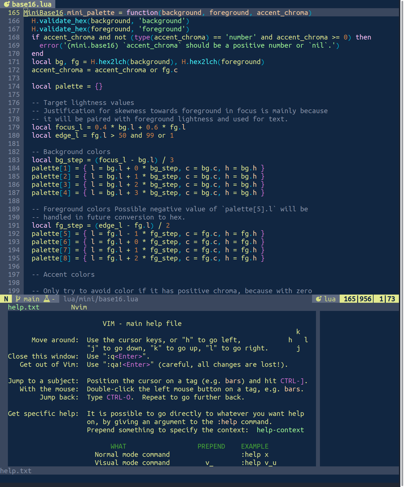
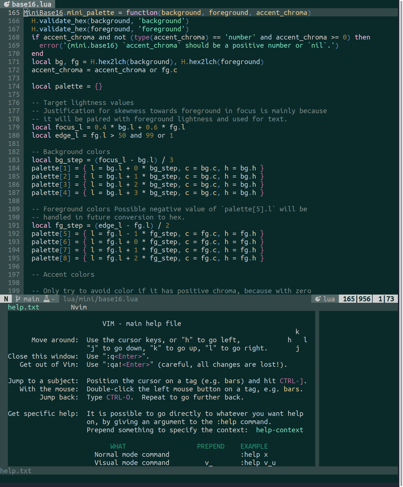
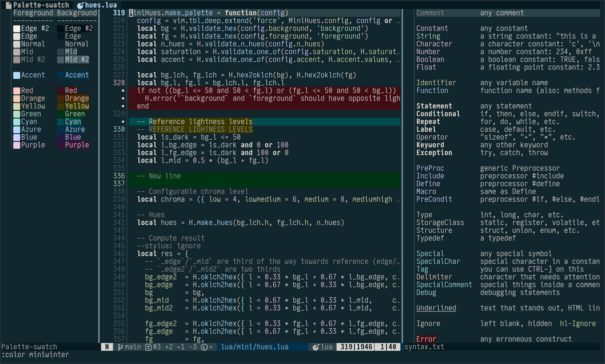
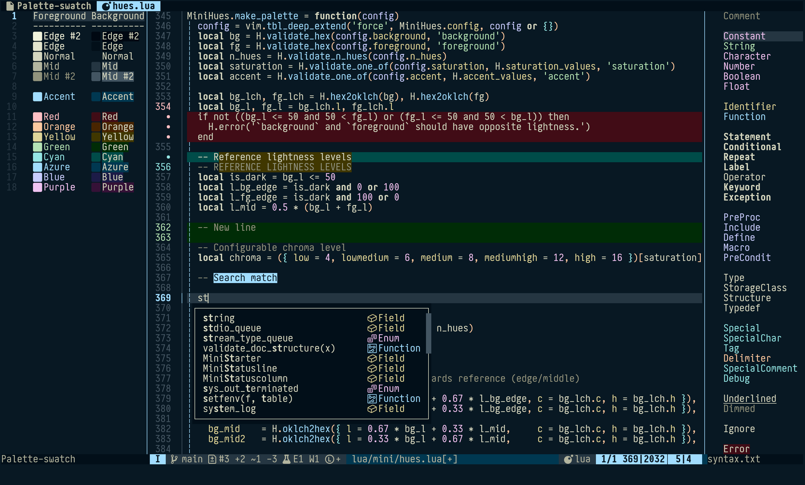
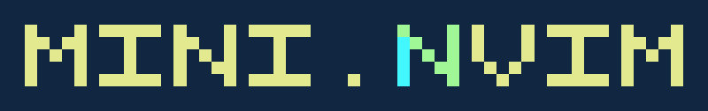

Hello, Neovim users!

Today marks exactly five years since the [initial public release of 'mini.nvim'](2021-10-13-announce-mini-nvim.qmd) (originally done as a [Reddit post](https://www.reddit.com/r/neovim/comments/q7fiov/mininvim_collection_of_minimal_independent_and/)). I would like to take this opportunity to celebrate its continued development by reflecting a bit on its past, present, future while also doing a small visual redesign of color scheme and logos.

## Reflections

### Past

It all started in the late spring of 2021, when I had the idea of giving back to the community by packaging several bits of my config under "one file per feature" type of plugin. This was a rather novel idea in the Neovim world, which at the time was experiencing the boom of early Lua adoption. After struggling with constant delays due to knew module ideas (I *really* didn't want to write custom autocompletion due to its complexity), the first public Reddit announcement was on October 13.

At first it was 12 modules, which already provided a lot of useful functionality. Color scheme based on `base16` (which we'll come back to). LSP and built-in based autocompletion. Comment and surround with out-of-the-box dot-repeat support (really proud of that one).

The initial response was mostly positive. User base grew, GitHub stars kept coming. I  vividly remember mixed feelings of reaching 300+ stars while sitting through bombing of my city in the late February 2022.

The most common criticism was "why not make this separate plugins". Around a year after initial release, 'mini.nvim' adopted [dual distribution model](2022-10-30-announce-dual-distribution.qmd). This proved to be a good decision as it made adoptions by "Neovim distributions" more tangible, which in turn contributed to overall awareness about the plugin.

The overall development goal quickly became "try to *fully* own my Neovim config", which it is still more or less today. The modules kept coming, mostly based on the functionality that I had from other plugins (although I always try to provide at least a different spin on it). Average module development time was roughly three weeks: 'mini.pick' took around three months, while 'mini.notify' was done in six days (from zero to fully tested and documented code).

As time went by, there were less plugins I wanted to remove from config and more time had to be spent on maintaining existing modules (which I oddly like very much). Together with some of my upstream involvement (default color scheme, built-in commenting based on 'mini.comment', built-in plugin manager based on 'mini.deps') and real life issues, the time between new modules and releases increased significantly. Which is a shame, but it is what it is. There are still a ton of ideas I want to make a reality, but all in due time.

About a year ago I was lucky enough to have found several people who agreed to reduce the bus factor of 'mini.nvim' development and became part of the team. I still prefer to do most of the work myself, but they help with other mandatory activities: issue/PR/discussion triage, early reaction to Neovim Nightly breaking the plugin, integrating 'mini.nvim' in other color schemes, help me get out of "analysis paralysis", etc. I am really grateful to them for all this.

### Present

At this moment in time, 'mini.nvim' has:

- 46 modules.
- 5102 test cases (I *think* this makes it the most tested Neovim plugin to date).
- 25985 lines of autogenerated documentation.
- 2254 commits.
- 2578 interaction on GitHub (issues/PRs/discussions).
- *Almost* 10k GitHub stars. And hopefully at least as many people who enjoy using it on the daily basis.

### Future

Hopefully, the future will continue to be similar to what is being done currently: basically continued maintenance and more new modules (like from [this list](/mini.nvim/index.md#planned-modules), but [there are more ideas](https://github.com/nvim-mini/mini.nvim/issues?q=is%3Aissue+state%3Aopen+label%3Anew-module)).

There is also one ambitious idea I'd like to share now: create a similar type of "all-in-one" companion plugin, but for language specific features and runtime files (filetype specific settings, snippets, tool configs, etc). With the (distant) goal of having "install 'mini.nvim' plus that plugin and you're good to go". This requires a lot of targeted knowledge and maintenance, so we'll see how this will turn out.

## Redesign

To commemorate the anniversary, I decided to make a small redesign of plugin's visual aspects: "main" plugin color scheme and logos for all MINI projects. I had more ideas, but life had other plans.

### Color scheme

The "main" color scheme of 'mini.nvim' evolved with the plugin and my knowledge of color theory.

The first iteration (originally `minischeme`, now known as `miniblue`) was a very vibrant yellow foreground on blue background implemented with 'mini.base16'. That color combination I like to this day, but the actual color choices were a bit too much:

To counter that, the next iteration was `minicyan`, a less vibrant grey-on-cyan color scheme:

After the development of 'mini.hues', I daily drove the `randomhue` color scheme, which (within reason) randomly generates foreground and background. But after a while I realized that having *some* fixed 'mini.hues' based color schemes is beneficial for users. And so, ["four seasons" color schemes](2025-07-10-announce-new-colorschemes.qmd) were born.

As I usually prefer colder colors, the `miniwinter` became the new "main" color scheme and the base for this site's initial design:

However, almost immediately after settling on this, I realized that I still very much like a more prominent "yellow on blue" approach. I ended up using it for personal website, although still daily driving the enjoyable `miniwinter` in Neovim.

After a bit of experimentation in other tools (desktop, shell, etc.) and later in Neovim, I am glad to present the latest iteration of the "main" color scheme `minischeme`:

It is a darker and bluer `miniwinter` variant. Reusing the `minischeme` name is technically a breaking change, but it feels worth it. Its foreground and background colors are currently used on this website.

Its light variant is an inverted "blue on yellow" variant, which looks really nice as an editor color scheme in my opinion. Although I am not currently a light theme enjoyer.

At the moment I really enjoy daily driving it. Let's hope this one will stay for longer than any other :)

### Logo

Every long standing project deserves a logo. As I am not a very artistic person, coming up with "pixel art font" idea was the best I could do. It also had a fitting "something big built from small parts" connotation to it while also being generalizable to standalone repositories and other projects.

As there are several letters `m` in the 'mini.nvim', the most fitting resolution seemed to be 5x5 pixel font. So here is the first attempt:

It still looks fine to me (except maybe colors) and was used for a pretty long time. About a year ago I realized that I like 3x5 font much better and refusing to use it only due to less legible `m` is not okay. So here is the second attempt:

However, the `m` illegibility issue was raised several times and was indeed a concern. It can be written off as "logos are allowed to be illegible as long as they are recognizable", but something still didn't feel right.

Recently I realized that vector graphics is a thing which I can use to create simple looking logos. And they are easier to put under version control. After several tries and experimentation, here is the new logo:

It is a marginal variation on the previous logo, replacing "png angled pixel art" with a "vectorized rounded simple lines" approach. It feels like it is still recognizable, while being much more legible.

I (currently) like it. As with the latest iteration of color scheme, let's hope it will stay like this for longer than its predecessors.

---

Thank you all for using 'mini.nvim'! Let's hope to see what next five years will bring to it.
